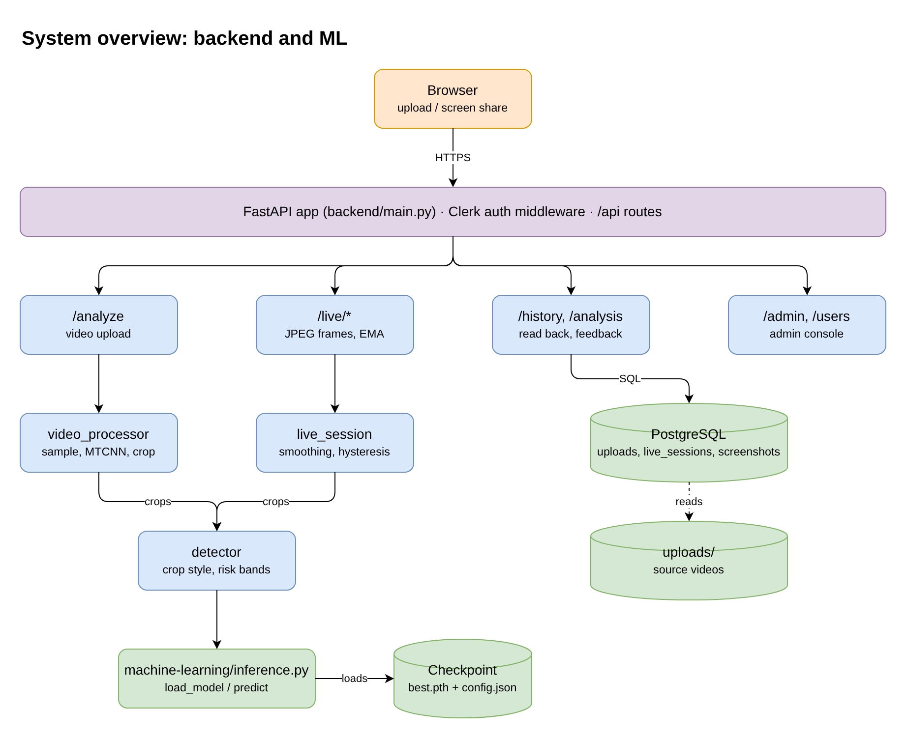
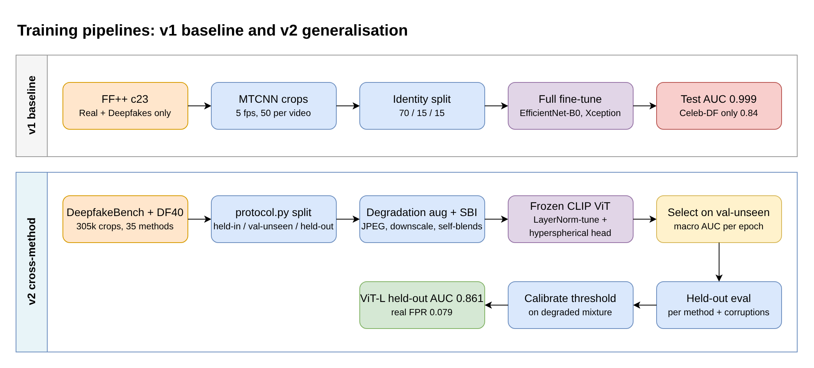
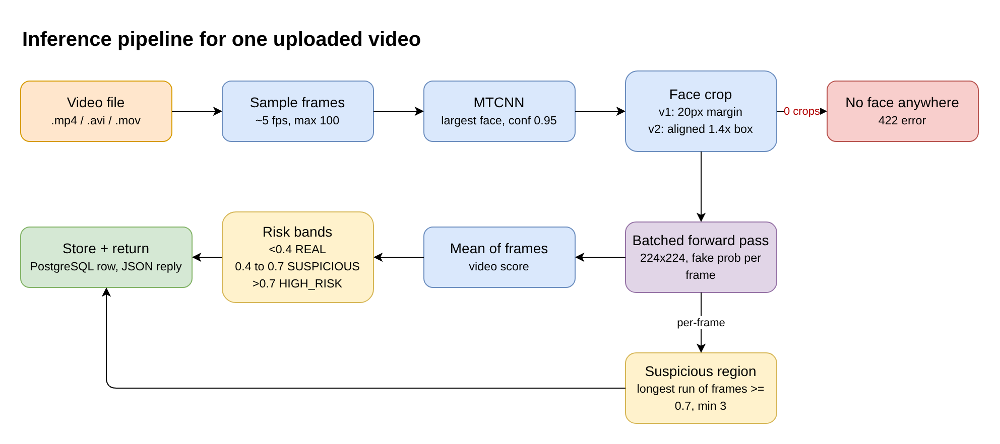

# Deepfake Detection and Alert System

A face-level deepfake detector and the service that runs it. You give it a video
(or a live screen share), it finds the face in each sampled frame, scores every
crop for how likely it is to be manipulated, and returns one verdict for the
whole clip along with the time window that looks most suspicious.

This README only covers the two research-heavy parts of the repo:

- `machine-learning/`: data preparation, training, evaluation and the
  `inference.py` interface for both model generations (v1 and v2).
- `backend/`: the FastAPI service that wraps the detector, does face
  detection and cropping, aggregates scores and stores results.

We have tried to write it the way one writes up a project report. What we
did, why we did it, what the numbers came out to, and where the thing still
fails. The failures are honestly the more interesting part.

---

## Abstract

Our first model (v1) is an EfficientNet-B0 fine-tuned end to end on the
FaceForensics++ "Deepfakes" manipulation. On its own test split it reaches
0.9989 frame-level ROC-AUC, which looks excellent, but on Celeb-DF-v2 (a
corpus it never saw) the same model drops to 0.84, and to 0.76 once the
frames are JPEG-compressed at quality 40. In plain words, the model had
learnt one generator, not the general idea of a fake face.

The v2 work tries to fix exactly this. We moved to a 305k-crop corpus covering
35 manipulation methods, kept a strict held-in / val-unseen / held-out method
split, froze a CLIP ViT backbone and trained only its LayerNorm parameters
plus a small hyperspherical head, and added Self-Blended Images and
codec-style degradation during training. On manipulations that were fully
excluded from training, held-out AUC went from 0.67 (EfficientNet on the same
data) to 0.82 with CLIP ViT-B/16 and 0.86 with CLIP ViT-L/14, while training
roughly 100x fewer parameters. Two failure cases remain and are analysed in
detail: SadTalker (a still-image talking head with almost no per-frame
signal) and MidJourney (where the score is actually inverted).

---

## 1. System overview



There is no separate model server. The backend imports
`machine-learning/inference.py` directly and loads the checkpoint into the
same process at startup. If no checkpoint is found, the server still boots in
a stub mode where every frame scores 0.5, so the rest of the app can be
developed without a GPU. `GET /health` tells you which mode is active.

The deployed checkpoint as of now is the v1 model,
`machine-learning/checkpoints/efficientnet_b0_20260901_204509`, tracked in
git through LFS. The v2 checkpoints are not shipped yet (see Section 6).

---

## 2. Repository layout

| Path | What it holds |
|---|---|
| `machine-learning/download_data.py`, `preprocessing.py`, `dataset.py`, `models.py`, `train.py`, `evaluate.py`, `compare.py` | v1 pipeline: FF++ download, MTCNN face crops, training and evaluation of EfficientNet-B0 and Xception |
| `machine-learning/protocol.py` | v2 method partition (held-in, val-unseen, held-out) and the generation-family map |
| `machine-learning/download_v2.py`, `build_dataset_v2.py` | fetch DeepfakeBench and DF40 zips and build `data/processed_v2` with a single manifest |
| `machine-learning/augment.py`, `sbi.py` | degradation augmentation presets and Self-Blended Images |
| `machine-learning/models_v2.py`, `dataset_v2.py`, `train_v2.py` | frozen-backbone models, SBI-aware balanced sampler, training loop |
| `machine-learning/evaluate_v2.py`, `diagnose_v2.py`, `calibrate_v2.py`, `temporal_v2.py`, `aggregate_v2.py` | per-method evaluation, score-distribution diagnosis, threshold calibration, temporal and aggregation studies |
| `machine-learning/report_v2.py`, `rank_runs.py`, `run_experiments.sh`, `finalize_v2.sh` | sweep runner and reports |
| `machine-learning/inference.py` | `load_model()` / `predict()`, dispatches on checkpoint version so v1 and v2 both load |
| `machine-learning/runs/*.md`, `*.csv` | the comparison reports and measurement CSVs quoted in this README |
| `backend/main.py`, `config.py`, `auth.py`, `database.py` | app setup, env config, Clerk token check, hand-written SQL schema |
| `backend/routes/` | `analyze`, `live`, `history`, `admin`, `users` |
| `backend/services/video_processor.py` | frame sampling, MTCNN, cropping, aggregation, risk status |
| `backend/services/detector.py` | model loading, batched prediction, crop style and risk bands per checkpoint |
| `backend/services/live_session.py` | per-session EMA smoothing, hysteresis, reaping of idle sessions |

---

## 3. v1: a strong in-domain baseline



### 3.1 Data

We took FaceForensics++ c23 from the public Hugging Face mirror
`bitmind/FaceForensicsC23`, so that the pipeline reproduces without the
official access form. Only two folders were used, `Real/` and `Deepfakes/`,
1,000 videos each.

`preprocessing.py` samples frames at 5 fps (max 50 per video), runs MTCNN,
keeps the largest face above confidence 0.95 and crops it with a 20 px margin.
MTCNN found a usable face in 99.83% of sampled frames, giving 99,586 crops,
almost perfectly balanced (49.98% fake).

The split is 70/15/15 by **source identity**, so `033.mp4` and `033_097.mp4`
always land in the same split. Without this, the model can simply recognise
the person and the test number becomes meaningless.

### 3.2 Training setup

| Setting | Value |
|---|---|
| Input | 224x224 RGB face crop, ImageNet normalisation |
| Augmentation | h-flip 0.5, affine ±10° / ±5% translate, colour jitter 0.2 |
| Head | pooled features, 128, ReLU, dropout 0.2, 1 logit |
| Loss | `BCEWithLogitsLoss` with `pos_weight` from the train ratio |
| Optimiser | Adam, lr 1e-4, weight decay 1e-5 |
| Precision | AMP fp16, grad-norm clip 1.0 |
| Early stopping | on val ROC-AUC, patience 5 |
| Fine-tuning | full backbone, nothing frozen |

Hardware for everything in this README: one RTX 4060 Laptop GPU (8 GB).

### 3.3 Results on the in-domain test split

Test split, 14,932 crops, threshold 0.5 (`machine-learning/runs/comparison.md`):

| Model | Accuracy | Precision | Recall | F1 | ROC-AUC | ms / img | Params |
|---|---|---|---|---|---|---|---|
| EfficientNet-B0 | 0.9912 | 0.9887 | 0.9938 | 0.9912 | 0.9989 | 2.76 | 4.2 M |
| Xception | 0.9858 | 0.9919 | 0.9796 | 0.9857 | 0.9990 | 2.08 | 21.1 M |

The AUC gap is 0.0001, which is noise, so we picked EfficientNet-B0 on F1,
size and training time (24 min against 42 min). Precision and recall were
basically flat between threshold 0.41 and 0.70, so the product's risk bands
did not need any retuning.

### 3.4 Why this was not good enough

Before starting v2 we measured the same v1 checkpoint outside its comfort zone:

| Test set | v1 frame AUC |
|---|---|
| FF++ Deepfakes c23 (own test split) | 0.9989 |
| Celeb-DF-v2 (unseen corpus) | 0.8400 |
| Celeb-DF-v2 at JPEG q40 | 0.7581 |
| Celeb-DF-v2 at 0.5x downscale | 0.7838 |

It also gave a score of 1.0 to an image of uniform noise. So the 0.999 was the
training manipulation getting memorised, not real detection ability. This is
a well known problem in deepfake detection and it is the whole reason for v2.

---

## 4. v2: aiming for cross-method generalisation

### 4.1 Three changes

1. **Corpus diversity.** 13 held-in manipulation families instead of one,
   spanning graphics face swap, learned face swap, reenactment / talking
   head, GAN synthesis and diffusion synthesis.
2. **Frozen foundation backbone.** A CLIP ViT where only the LayerNorm affine
   parameters and the head are trained (41k params for ViT-B/16, 103k for
   ViT-L/14), following LNCLIP-DF. Full fine-tuning is exactly what let v1
   overwrite generic features with method-specific ones.
3. **Degradation augmentation and Self-Blended Images (SBI).** Training crops
   are clean PNGs, but deployment frames are codec output, so `augment.py`
   adds JPEG, downscale and similar corruptions. SBI makes pseudo-fakes from
   real faces alone by blending a face with a slightly transformed copy of
   itself, which teaches the blending boundary that every face swap shares
   irrespective of the generator.

### 4.2 Data and protocol

Sources: Celeb-DF-v2, FF++, DFDCP and UADFV through DeepfakeBench, plus the
DF40 train and test sets. After ingestion `data/processed_v2/manifest.csv` has
**305,666 rows**.

`protocol.py` splits methods three ways:

- **held-in** (used for training): Deepfakes, Face2Face, faceswap, blendface,
  facedancer, fsgan, fomm, facevid2vid, lia, wav2lip, StyleGAN2, ddim, DiT
- **val-unseen** (only for picking the epoch): FaceSwap, mobileswap, tpsm, VQGAN
- **held-out** (the honest number): inswap, simswap, uniface, e4s,
  deepfacelab, sadtalker, heygen, hyperreenact, mcnet, NeuralTextures,
  FaceShifter, DeepFakeDetection, SiT, StyleGAN3, MidJourney, CollabDiff,
  stargan, starganv2, styleclip, whichfaceisreal, and the Celeb-DF-v2, DFDCP
  and UADFV corpora

InSwapper and SimSwap are held out on purpose. These are the swaps someone is
most likely to actually use today, so they should be the exam, not the
syllabus. Splitting is by hashed target identity across every corpus, so one
person never sits in two splits.

One subtle point about crop framing. The video corpora all come as
DeepfakeBench-aligned 256x256 crops. If we cropped our reals with a different
detector, the model would get a free shortcut ("MTCNN framing means real").
So the backend reproduces the DeepfakeBench framing for v2 checkpoints (see
Section 5.2).

### 4.3 Main results

Held-out AUC is the mean per-method AUC over manipulations that were never
trained on, each scored against the shared real pool.

| Run | Trainable params | val-unseen AUC | **held-out AUC** | video AUC | real FPR @ 0.5 |
|---|---|---|---|---|---|
| EfficientNet-B0, v2 data | 4.17 M | 0.9048 | **0.6715** | 0.7874 | 0.220 |
| CLIP ViT-B/16, LN-tuned | 0.041 M | 0.9679 | **0.8200** | 0.8871 | 0.086 |
| CLIP ViT-L/14, LN-tuned | 0.103 M | 0.9803 | **0.8611** | 0.9247 | 0.079 |

The EfficientNet row is the control: v1's architecture on v2's data, same
augmentation, same SBI, same sampler. Changing only the backbone and what is
trained moved held-out AUC from 0.67 to 0.82. The false positive rate on real
faces fell to 0.086 without any threshold tuning.

Another thing we noticed: for both CLIP runs, unseen AUC stays *above*
in-domain val AUC at every epoch, while the EfficientNet run crossed over at
epoch 4 (in-domain still rising, unseen already falling). LN-tuning simply
does not have the capacity to memorise the training manipulations. It also
means that if we had selected on in-domain val, we would have shipped a worse
detector.

### 4.4 Robustness to compression and scaling

| Condition | EfficientNet | ViT-B/16 | ViT-B FPR | ViT-L/14 | ViT-L FPR |
|---|---|---|---|---|---|
| clean | 0.6715 | 0.8200 | 0.086 | **0.8611** | 0.079 |
| JPEG q40 | 0.6512 | 0.7932 | 0.143 | **0.8245** | 0.075 |
| downscale 0.25x | 0.6286 | 0.7609 | 0.189 | **0.8013** | 0.151 |
| JPEG q10 | 0.6293 | 0.6910 | 0.493 | **0.7259** | 0.186 |

AUC degrades gracefully, but at JPEG q10 the false positive rate jumps,
which means the score distribution of real faces shifts bodily. The training
augmentation never went below q30, so we tried a wider range (`heavy_wide`,
JPEG floor 12). That brought ViT-B's q10 FPR from 0.494 to 0.316, so roughly a
third of the gap. Picking the threshold on a mixture of clean and degraded
frames (`calibrate_v2.py`) instead of clean PNG moved the operating point
from 0.495 to 0.619 and kept video-level FPR between 0.048 and 0.176 across
clean, q40, q20 and 0.5x downscale. So bigger backbone, wider augmentation and
calibrated threshold are three independent levers on the same problem, and
calibration is the cheapest one.

### 4.5 Ablations (ViT-B/16, one factor changed at a time)

| Run | held-out AUC | FPR clean | FPR q10 | val-unseen |
|---|---|---|---|---|
| light augmentation | 0.8536 | 0.088 | 0.452 | 0.9627 |
| MLP head instead of hyperspherical | 0.8204 | 0.158 | 0.486 | 0.9582 |
| no latent augmentation | 0.8086 | 0.094 | 0.467 | 0.9673 |
| heavy_wide augmentation | 0.7938 | 0.102 | 0.316 | 0.9671 |
| **no SBI** | **0.7296** | 0.124 | 0.253 | 0.9678 |
| linear probe (backbone fully frozen) | 0.6407 | 0.279 | 0.698 | 0.9251 |

These ablations average over 23 held-out methods while the main table above
averages over 14, so do not compare AUC across the two tables directly. FPR is
comparable since it is measured on the same real pool.

What we take from this:

- **SBI is the biggest single contributor, and our selection metric cannot
  see it.** Without SBI, val-unseen is 0.9678 against the baseline's 0.9679,
  but held-out swaps collapse (inswap 0.425, simswap 0.494). Val-unseen picks
  the epoch, it does not validate the recipe.
- **LN-tuning is doing the real work, not the head.** Freezing everything
  and training only the head gives 0.64, below even the EfficientNet control.
- **The hyperspherical head mostly buys calibration.** The MLP head keeps
  similar AUC but nearly doubles the false positive rate.

---

## 5. Backend

### 5.1 Upload pipeline



`backend/services/video_processor.py` does the following for each upload:

1. Sample frames at about 5 fps with OpenCV and thin them uniformly to at most
   100, the same two-stage sampling used to build the training crops.
2. Run MTCNN, keep the largest box above confidence 0.95, skip frames with no
   face. If no frame has a face, the request fails with 422.
3. Crop the face in the convention the loaded checkpoint was trained on.
4. Score all crops in one batched forward pass through `detector.predict_batch`.
5. The video score is the **mean** of frame scores. It is mapped to `REAL`
   (below 0.4), `SUSPICIOUS` (0.4 to 0.7) or `HIGH_RISK` (above 0.7). The
   suspicious region is the longest contiguous run of frames at or above 0.7,
   reported only if it is at least 3 frames long.
6. The row goes to PostgreSQL (`uploads` table, frame scores as `JSONB`) and
   the full result comes back synchronously.

We also checked whether some other video-level aggregator would be better
(`aggregate_v2.py`, seven options on the ViT-L scores). `max` wins on
held-out AUC (0.8610 against 0.8468 for the mean) only because AUC rewards
spread, but at a matched 5% false positive rate `max` is the worst of the
seven (0.6018 recall) and mean / median are the best (0.6482 / 0.6572). So we
kept the mean.

### 5.2 Crop convention follows the checkpoint

A detector is only as good as the match between training crops and serving
crops. `detector.crop_style()` reads the loaded checkpoint's version:

- v1 checkpoints get the old MTCNN box plus a fixed 20 px margin.
- v2 checkpoints get an `aligned` crop: a square of side `1.4 * max(w, h)`
  centred on the MTCNN box and raised by `0.10 * side`, reflect-padded at the
  frame edges. These constants were fitted by matching MTCNN boxes on raw
  FF++ videos against the DeepfakeBench crops (median normalised
  cross-correlation 0.79 over 25 videos).

Similarly `detector.risk_bands()` reads the operating point that
`calibrate_v2.py` writes into the checkpoint, and that wins over the
`RISK_SUSPICIOUS` / `RISK_HIGH` / `FRAME_THRESHOLD` env values, otherwise a
calibrated checkpoint would silently never take effect.
`RISK_BANDS_SOURCE=env` forces the env values back.

### 5.3 Live screen share

The browser opens a session and posts a 640 px JPEG roughly twice a second.
Frames stay in memory only for the length of the request and are never
written to disk. To keep it cheap, MTCNN runs only every `LIVE_DETECT_EVERY`
frames (default 5) and the box is reused in between, since detection costs
about 2.3x the rest of the per-frame work. The badge reads an EMA of the
scores (`LIVE_EMA_ALPHA`, default 0.2), and leaving a state needs an extra
margin of `RISK_HYSTERESIS` (default 0.1), so a score sitting right on a
threshold does not make the badge flicker. If a frame arrives while the
previous one is still being scored, it is dropped rather than queued. Idle
sessions are reaped after `LIVE_SESSION_TTL` seconds.

One practical finding: JPEG quality on the capture side is not a free knob.
The v1 model reads a known fake as REAL below about quality 0.85, so the
capture path uses 0.95.

### 5.4 API

All routes sit under `/api`. With `CLERK_PUBLISHABLE_KEY` set, everything
except `/health`, `/api/config`, registration
and admin login needs a Clerk session token, and every row
belongs to the user who created it.

| Method | Path | Purpose |
|---|---|---|
| `GET` | `/health` | liveness, and whether a real checkpoint is loaded |
| `POST` | `/api/analyze` | upload a video (multipart field `file`), get the full analysis |
| `GET` | `/api/analysis/{id}` | one stored analysis |
| `GET` | `/api/analysis/{id}/video` | source video with range support |
| `POST` | `/api/analysis/{id}/feedback`, `.../rerun` | user feedback, rerun with the current model |
| `GET` | `/api/history` | uploads and live sessions together, newest first |
| `POST` | `/api/live/start`, `/{session}/frame`, `/{session}/stop` | live session lifecycle |
| `POST` | `/api/live/frame`, `/api/live/screenshot` | stateless single-frame scoring |
| `POST` | `/api/auth/register` | create an account |
| `*` | `/api/admin/*` | admin login and read-only table browser |

Swagger is available at `/docs` once the server is running.

---

## 6. Limitations and open problems

**SadTalker (held-out AUC 0.42 on ViT-L).** This is not a capacity problem.
Across EfficientNet, ViT-B and ViT-L, hyperreenact goes 0.63, 0.93, 0.96 while
SadTalker stays at 0.28, 0.46, 0.42. SadTalker animates one still image from
audio, so per frame the crop is almost entirely unmodified pixels. We measured
within-video pixel standard deviation (`temporal_v2.py`): 2.99 for SadTalker
against 16.31 for real Celeb-DF video, with 16% of that little variation
sitting in the mouth. That single number, no network at all, separates
SadTalker from real video at AUC 0.99 (0.96 after controlling for sampling
interval). But it is useless as a general detector, since most manipulations
are *more* variable than real footage. So the right fix is a separate
video-level signal that can raise the verdict, not something blended into the
frame score. This is not wired into the backend yet.

**MidJourney (held-out AUC 0.32).** Unlike SadTalker this one is properly
inverted: MidJourney images score a median 0.047 against 0.091 for real faces,
so some cue is firing backwards. A part of it is a crop-size confound (these
fakes come at 1024 px and get downsampled 4.6x), but controlling for that
still leaves it a failure.

**Other things worth stating plainly:**

- The v2 comparison table mixes runs scored on 14 and on 23 held-out methods.
  `finalize_v2.sh` re-scores everything with identical flags and has to be run
  before the rows can be ranked against each other.
- The sweep was paused before `clipl_heavy_wide`, `dinov3l_full` and
  `convnext_full`. Ensembling is implemented but not measured.
- The deployed backend still serves v1. `archive/docs/smoke_test.py` has not
  yet been run against a v2 checkpoint, which is the one end-to-end check that the
  aligned crop and calibrated thresholds behave inside the real service.
- Deepfake-Eval-2024 would be a better in-the-wild final test than anything we
  hold out, but it is gated and needs an approved Hugging Face account.
- All numbers are frame-level unless marked "video". A detector like this
  gives a probability, not proof. Please do not use it as the only basis for
  any serious decision about a real person.

---

## 7. Reproducing

Python 3.12 (torch had no 3.14 wheels when this was set up).

```bash
uv venv --python 3.12 .venv
.venv/bin/python -m pip install -r machine-learning/requirements.txt
# facenet-pytorch pins an old torchvision in its metadata, its MTCNN works fine on current torchvision
.venv/bin/python -m pip install --no-deps 'facenet-pytorch>=2.6'
```

**v1**

```bash
.venv/bin/python machine-learning/download_data.py --out data/raw
.venv/bin/python machine-learning/preprocessing.py --raw data/raw --out data/processed \
    --fps 5 --max-frames 50 --margin 20 --conf 0.95 --seed 42
.venv/bin/python machine-learning/train.py --model efficientnet_b0 --data data/processed \
    --epochs 15 --batch-size 64 --lr 1e-4 --amp --patience 5
.venv/bin/python machine-learning/evaluate.py --amp \
    --checkpoint machine-learning/checkpoints/efficientnet_b0_<ts> --data data/processed
```

**v2**

```bash
.venv/bin/python machine-learning/download_v2.py           # about 89 GB of zips into data/dl
.venv/bin/python machine-learning/build_dataset_v2.py      # data/processed_v2 + manifest.csv
bash machine-learning/run_experiments.sh core              # also: ablations / large / all
bash machine-learning/finalize_v2.sh                       # re-score, rank, sweep, calibrate, ensemble
```

**Backend**

```bash
.venv/bin/python -m pip install -r backend/requirements.txt
# create backend/.env with NEON_DB_URL, optionally MODEL_DIR and CLERK_PUBLISHABLE_KEY
./run.sh                               # serves on :8000
```

`MODEL_DIR` can point at a single run directory or at the parent
`checkpoints/` folder, in which case the most recently written run is loaded.
Using the model from your own code is two lines:

```python
from inference import load_model, predict   # with machine-learning/ on sys.path
model = load_model("machine-learning/checkpoints/efficientnet_b0_20260901_204509")
prob = predict(model, face_crop_rgb)        # path, PIL image, RGB ndarray or a list of these
```

---

## 8. References

- Rössler et al., *FaceForensics++: Learning to Detect Manipulated Facial Images*, ICCV 2019.
- Li et al., *Celeb-DF: A Large-scale Challenging Dataset for DeepFake Forensics*, CVPR 2020.
- Yan et al., *DeepfakeBench: A Comprehensive Benchmark of Deepfake Detection*, NeurIPS 2023.
- Yan et al., *DF40: Toward Next-Generation Deepfake Detection*, NeurIPS 2024.
- Shiohara and Yamasaki, *Detecting Deepfakes with Self-Blended Images*, CVPR 2022.
- *LNCLIP-DF*, arXiv:2503.19683 (LayerNorm-tuned CLIP for deepfake detection).
- Radford et al., *Learning Transferable Visual Models From Natural Language Supervision* (CLIP), ICML 2021.
- Tan and Le, *EfficientNet*, ICML 2019. Chollet, *Xception*, CVPR 2017.
- Zhang et al., *Joint Face Detection and Alignment using Multi-task Cascaded Convolutional Networks* (MTCNN), 2016.

The diagrams were made in draw.io. Their editable sources are in
`docs/diagrams/*.drawio`.
